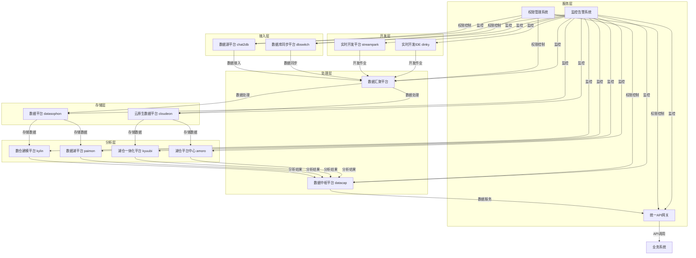

# 数据中台项目开发详细设计文档

## 1. 项目概述

### 1.1 项目背景
随着企业数字化转型的深入，数据已成为企业的核心资产。然而，传统的数据管理模式存在数据孤岛、重复建设、治理混乱等问题，严重制约了数据价值的释放。数据中台作为一种新型的数据管理架构，旨在构建统一、共享、敏捷、智能的企业级数据服务能力中心，为业务创新提供强大的数据支撑。

### 1.2 项目目标
- 构建统一的数据接入与管理平台
- 实现高效的数据集成与同步
- 建立智能的数据存储与计算体系
- 提供敏捷的数据开发与分析能力
- 打造安全可靠的数据服务体系
- 建立完善的数据治理体系

### 1.3 项目范围
- 数据源平台（chat2db）
- 数据库同步平台（dbswitch）
- 数据中枢平台（datacap）
- 数据汇聚平台（transport、tis、seatunweb）
- 数据存储平台（datasophon、cloudeon）
- 数据分析平台（kylin、paimon、kyuubi、amoro）
- 数据开发平台（streampark、dinky）
- 统一服务层（API网关、权限管理、监控告警）

## 2. 技术架构设计

### 2.1 整体架构

### 2.2 技术栈选型

| 类别 | 技术 | 版本 | 用途 | 选型理由 |
|------|------|------|------|----------|
| 前端框架 | React | 18.x | 前端开发 | 生态成熟，组件丰富，性能优异 |
| UI组件库 | Ant Design | 5.x | 前端UI | 企业级组件库，美观易用 |
| 后端语言 | Java | 17 | 后端开发 | 生态成熟，性能稳定，适合企业级应用 |
| 后端框架 | Spring Boot | 3.x | 后端开发 | 快速开发，微服务支持，生态丰富 |
| 微服务框架 | Spring Cloud | 2022.x | 微服务治理 | 完整的微服务生态 |
| 数据接入 | Kafka | 3.x | 实时数据采集 | 高吞吐量，可靠性强 |
| 数据接入 | Flume | 1.11.x | 日志采集 | 灵活的数据源适配 |
| 数据接入 | NiFi | 1.23.x | 数据集成 | 可视化流程设计 |
| 数据存储 | HDFS | 3.x | 分布式存储 | 成熟稳定，适合大数据存储 |
| 数据存储 | MinIO | 2023.x | 对象存储 | 兼容S3 API，轻量级 |
| 数据计算 | Spark | 3.x | 批处理 | 高性能，生态丰富 |
| 数据计算 | Flink | 1.17.x | 流处理 | 低延迟，状态管理 |
| 数据查询 | Presto | 0.280+ | 交互式查询 | 高性能，多数据源支持 |
| 数据查询 | ClickHouse | 23.x | 分析型数据库 | 列式存储，查询速度快 |
| 元数据管理 | Apache Atlas | 2.3.x | 元数据与血缘 | 企业级元数据管理 |
| 调度系统 | Apache Airflow | 2.6.x | 任务调度 | 灵活的工作流编排 |
| 监控系统 | Prometheus | 2.40+ | 指标监控 | 强大的监控能力 |
| 监控系统 | Grafana | 9.x | 可视化监控 | 丰富的仪表盘 |
| 容器编排 | Kubernetes | 1.26+ | 容器管理 | 强大的容器编排能力 |
| API网关 | Spring Cloud Gateway | 4.x | API管理 | 轻量级，集成Spring Cloud |
| 认证授权 | Spring Security | 6.x | 安全管理 | 成熟的安全框架 |

### 2.3 关键技术设计

#### 2.3.1 数据接入架构
- **批流一体**：采用Kafka作为统一的消息中间件，支持实时和批量数据接入
- **CDC技术**：使用Debezium实现数据库变更捕获，确保数据实时同步
- **多源适配**：通过统一的连接器框架，支持多种数据源类型
- **数据质量**：在接入层实现基础的数据质量检查，如格式验证、重复数据检测

#### 2.3.2 数据存储架构
- **分层存储**：
  - 原始数据层（Raw）：存储原始数据，保持数据原貌
  - 清洗数据层（Cleaned）：经过基础清洗的数据
  - 业务数据层（Business）：按照业务模型组织的数据
  - 汇总数据层（Summary）：预计算的汇总数据
- **湖仓一体**：采用Apache Iceberg作为统一存储格式，实现数据湖和数据仓库的融合
- **冷热数据**：根据数据访问频率，实现数据的冷热分层存储

#### 2.3.3 数据计算架构
- **流批一体**：采用Flink和Spark结合的方式，实现流处理和批处理的统一
- **资源隔离**：使用Kubernetes的命名空间和资源配额，实现计算资源的隔离
- **弹性伸缩**：根据任务负载，自动调整计算资源

#### 2.3.4 数据服务架构
- **API网关**：统一的API入口，实现路由、负载均衡、限流等功能
- **服务注册与发现**：使用Nacos实现服务的注册与发现
- **服务编排**：使用Spring Cloud Alibaba实现服务的编排和治理
- **安全认证**：基于OAuth2.0和JWT的认证授权机制

## 3. 核心功能模块设计

### 3.1 数据源平台（chat2db）

#### 3.1.1 功能模块
- **数据源管理**：数据源的增删改查，连接测试，状态监控
- **SQL编辑器**：语法高亮，智能提示，SQL格式化
- **查询执行**：SQL执行，结果展示，导出
- **权限管理**：数据源访问权限控制，操作审计
- **连接池管理**：连接池配置，性能监控

#### 3.1.2 技术实现
- 前端：React + Ant Design + Monaco Editor
- 后端：Spring Boot + MyBatis + HikariCP
- 数据源连接器：使用JDBC、ODBC等标准接口
- 连接池：HikariCP，支持多种数据库

#### 3.1.3 关键类与接口
| 类/接口名 | 职责 | 参数 | 返回值 |
|----------|------|------|--------|
| DataSourceService | 数据源管理服务 | 数据源配置 | 数据源信息 |
| SqlExecutorService | SQL执行服务 | SQL语句，数据源ID | 查询结果 |
| ConnectionPoolManager | 连接池管理 | 数据源ID | 连接池状态 |
| PermissionService | 权限管理服务 | 用户ID，资源ID，操作类型 | 权限检查结果 |

### 3.2 数据库同步平台（dbswitch）

#### 3.2.1 功能模块
- **同步任务管理**：任务的创建、编辑、删除、启动、停止
- **同步配置**：源数据库、目标数据库、同步策略配置
- **同步监控**：任务执行状态、进度、日志
- **同步历史**：历史执行记录，失败原因分析
- **数据一致性**：数据校验，冲突处理

#### 3.2.2 技术实现
- 前端：React + Ant Design + ECharts
- 后端：Spring Boot + Quartz + MyBatis
- 同步引擎：基于JDBC和自定义实现
- 监控：Prometheus + Grafana

#### 3.2.3 关键类与接口
| 类/接口名 | 职责 | 参数 | 返回值 |
|----------|------|------|--------|
| SyncTaskService | 同步任务管理 | 任务配置 | 任务状态 |
| SyncEngine | 同步引擎 | 源数据库，目标数据库，同步策略 | 同步结果 |
| DataValidator | 数据校验 | 源数据，目标数据 | 校验结果 |
| SyncMonitor | 同步监控 | 任务ID | 监控数据 |

### 3.3 数据中枢平台（datacap）

#### 3.3.1 功能模块
- **元数据管理**：元数据采集、存储、查询、分析
- **数据血缘**：血缘关系的自动发现、可视化、分析
- **数据质量**：质量规则定义、执行、监控、报告
- **数据资产**：资产目录、标签管理、资产画像
- **数据服务**：服务编排、API管理、服务目录

#### 3.3.2 技术实现
- 前端：React + Ant Design + D3.js
- 后端：Spring Boot + Apache Atlas + Elasticsearch
- 元数据采集：自定义采集器 + Atlas集成
- 血缘分析：基于SQL解析和执行计划分析

#### 3.3.3 关键类与接口
| 类/接口名 | 职责 | 参数 | 返回值 |
|----------|------|------|--------|
| MetadataService | 元数据管理 | 元数据类型，查询条件 | 元数据信息 |
| LineageService | 血缘分析 | 数据资产ID | 血缘关系图 |
| QualityService | 数据质量 | 质量规则，数据资产 | 质量评估结果 |
| AssetService | 资产管理 | 资产ID，标签 | 资产信息 |
| ServiceOrchestration | 服务编排 | 服务配置 | 服务实例 |

### 3.4 数据汇聚平台

#### 3.4.1 数据集成管理（transport）
- **连接器管理**：连接器的配置、测试、监控
- **ETL任务**：任务设计、调度、执行、监控
- **数据转换**：转换规则配置、测试、执行
- **集成监控**：任务执行状态、日志、告警

#### 3.4.2 数据集成平台（tis）
- **实时采集**：实时数据采集配置、监控
- **批处理**：批处理任务配置、调度、执行
- **数据路由**：数据路由规则配置、执行
- **流程设计**：可视化流程设计、测试、部署

#### 3.4.3 数据同步平台（seatunweb）
- **跨系统同步**：系统间数据同步配置、执行
- **双向同步**：双向同步策略配置、冲突处理
- **同步监控**：同步状态、进度、日志
- **同步历史**：历史记录查询、分析

### 3.5 数据存储平台

#### 3.5.1 数据平台（datasophon）
- **集群管理**：集群的创建、配置、监控、运维
- **资源管理**：资源分配、调度、监控
- **存储策略**：存储策略配置、执行、监控
- **生命周期**：数据生命周期管理、执行、监控

#### 3.5.2 云原生数据平台（cloudeon）
- **容器管理**：容器的创建、配置、监控、运维
- **弹性伸缩**：资源弹性伸缩配置、执行、监控
- **多环境**：多环境管理、配置、部署
- **云服务集成**：云服务的集成、配置、监控

### 3.6 数据分析平台

#### 3.6.1 数仓建模平台（kylin）
- **多维分析**：维度模型设计、OLAP分析
- **预计算**：立方体设计、构建、优化
- **查询引擎**：查询优化、执行、监控
- **指标体系**：指标定义、计算、管理

#### 3.6.2 数据湖平台（paimon）
- **原始数据**：原始数据存储、管理、访问
- **格式管理**：数据湖格式配置、执行、监控
- **流批一体**：流处理和批处理的统一
- **版本控制**：数据版本管理、回滚、查询

#### 3.6.3 湖仓一体化平台（kyuubi）
- **统一SQL**：统一SQL访问接口、执行、优化
- **多引擎协同**：多计算引擎的协同、管理
- **资源隔离**：资源隔离配置、执行、监控
- **查询优化**：查询计划优化、执行、监控

#### 3.6.4 湖仓平台中心（amoro）
- **元数据管理**：元数据统一管理、同步、查询
- **数据治理**：治理策略配置、执行、监控
- **跨平台访问**：跨平台数据访问配置、执行
- **存储优化**：存储优化策略配置、执行、监控

### 3.7 数据开发平台

#### 3.7.1 实时开发平台（streampark）
- **作业开发**：流处理作业的设计、编码、测试
- **数据管道**：实时数据管道的设计、配置、监控
- **作业监控**：作业执行状态、指标、告警
- **版本管理**：代码版本管理、回滚、发布

#### 3.7.2 实时开发IDE（dinky）
- **编辑器**：可视化作业编辑器、代码编辑器
- **智能提示**：代码智能提示、语法检查
- **调试测试**：作业调试、测试、性能分析
- **协作评审**：代码评审、协作开发、权限管理

### 3.8 统一服务层

#### 3.8.1 统一API网关
- **路由管理**：API路由配置、执行、监控
- **负载均衡**：请求负载均衡配置、执行、监控
- **限流熔断**：限流熔断配置、执行、监控
- **安全认证**：API安全认证、授权、审计

#### 3.8.2 权限管理系统
- **用户管理**：用户的创建、编辑、删除、查询
- **角色管理**：角色的创建、编辑、删除、查询
- **权限管理**：权限的配置、分配、审计
- **认证授权**：认证策略配置、执行、监控

#### 3.8.3 监控告警系统
- **系统监控**：系统运行状态、指标、告警
- **业务监控**：业务指标、日志、告警
- **性能监控**：性能指标、瓶颈分析、告警
- **安全监控**：安全事件、审计、告警

## 4. 数据模型设计

### 4.1 核心数据模型

#### 4.1.1 数据源模型
| 字段名 | 数据类型 | 描述 | 约束 |
|--------|----------|------|------|
| id | BIGINT | 数据源ID | PRIMARY KEY |
| name | VARCHAR(255) | 数据源名称 | NOT NULL |
| type | VARCHAR(50) | 数据源类型 | NOT NULL |
| host | VARCHAR(255) | 主机地址 | NOT NULL |
| port | INT | 端口号 | NOT NULL |
| database | VARCHAR(255) | 数据库名称 | NOT NULL |
| username | VARCHAR(255) | 用户名 | NOT NULL |
| password | VARCHAR(255) | 密码（加密存储） | NOT NULL |
| status | VARCHAR(20) | 状态 | NOT NULL |
| create_time | TIMESTAMP | 创建时间 | NOT NULL |
| update_time | TIMESTAMP | 更新时间 | NOT NULL |

#### 4.1.2 同步任务模型
| 字段名 | 数据类型 | 描述 | 约束 |
|--------|----------|------|------|
| id | BIGINT | 任务ID | PRIMARY KEY |
| name | VARCHAR(255) | 任务名称 | NOT NULL |
| source_id | BIGINT | 源数据源ID | NOT NULL |
| target_id | BIGINT | 目标数据源ID | NOT NULL |
| sync_type | VARCHAR(50) | 同步类型 | NOT NULL |
| sync_strategy | JSON | 同步策略 | NOT NULL |
| status | VARCHAR(20) | 状态 | NOT NULL |
| create_time | TIMESTAMP | 创建时间 | NOT NULL |
| update_time | TIMESTAMP | 更新时间 | NOT NULL |

#### 4.1.3 元数据模型
| 字段名 | 数据类型 | 描述 | 约束 |
|--------|----------|------|------|
| id | BIGINT | 元数据ID | PRIMARY KEY |
| name | VARCHAR(255) | 元数据名称 | NOT NULL |
| type | VARCHAR(50) | 元数据类型 | NOT NULL |
| description | TEXT | 描述 | |
| attributes | JSON | 属性 | |
| create_time | TIMESTAMP | 创建时间 | NOT NULL |
| update_time | TIMESTAMP | 更新时间 | NOT NULL |

#### 4.1.4 数据资产模型
| 字段名 | 数据类型 | 描述 | 约束 |
|--------|----------|------|------|
| id | BIGINT | 资产ID | PRIMARY KEY |
| name | VARCHAR(255) | 资产名称 | NOT NULL |
| type | VARCHAR(50) | 资产类型 | NOT NULL |
| metadata_id | BIGINT | 关联元数据ID | NOT NULL |
| tags | JSON | 标签 | |
| status | VARCHAR(20) | 状态 | NOT NULL |
| create_time | TIMESTAMP | 创建时间 | NOT NULL |
| update_time | TIMESTAMP | 更新时间 | NOT NULL |

#### 4.1.5 数据服务模型
| 字段名 | 数据类型 | 描述 | 约束 |
|--------|----------|------|------|
| id | BIGINT | 服务ID | PRIMARY KEY |
| name | VARCHAR(255) | 服务名称 | NOT NULL |
| type | VARCHAR(50) | 服务类型 | NOT NULL |
| url | VARCHAR(255) | 服务URL | NOT NULL |
| params | JSON | 参数 | |
| status | VARCHAR(20) | 状态 | NOT NULL |
| create_time | TIMESTAMP | 创建时间 | NOT NULL |
| update_time | TIMESTAMP | 更新时间 | NOT NULL |

### 4.2 数据字典

#### 4.2.1 数据源类型
| 类型值 | 描述 |
|--------|------|
| MYSQL | MySQL数据库 |
| ORACLE | Oracle数据库 |
| POSTGRESQL | PostgreSQL数据库 |
| SQLSERVER | SQL Server数据库 |
| MONGODB | MongoDB数据库 |
| HIVE | Hive数据仓库 |
| KAFKA | Kafka消息队列 |
| REDIS | Redis缓存 |
| ELASTICSEARCH | Elasticsearch搜索引擎 |

#### 4.2.2 同步类型
| 类型值 | 描述 |
|--------|------|
| FULL | 全量同步 |
| INCREMENTAL | 增量同步 |
| REAL_TIME | 实时同步 |

#### 4.2.3 资产类型
| 类型值 | 描述 |
|--------|------|
| TABLE | 表 |
| VIEW | 视图 |
| API | API接口 |
| REPORT | 报表 |
| MODEL | 模型 |

## 5. 接口设计

### 5.1 数据源平台接口

#### 5.1.1 数据源管理
- **创建数据源**
  - URL: /api/datasource
  - Method: POST
  - Request Body: {
    "name": "数据源名称",
    "type": "数据源类型",
    "host": "主机地址",
    "port": 端口号,
    "database": "数据库名称",
    "username": "用户名",
    "password": "密码"
  }
  - Response: {
    "code": 200,
    "data": {
      "id": 1,
      "name": "数据源名称",
      "status": "CREATED"
    },
    "message": "成功"
  }

- **测试数据源连接**
  - URL: /api/datasource/test
  - Method: POST
  - Request Body: {
    "type": "数据源类型",
    "host": "主机地址",
    "port": 端口号,
    "database": "数据库名称",
    "username": "用户名",
    "password": "密码"
  }
  - Response: {
    "code": 200,
    "data": {
      "success": true,
      "message": "连接成功"
    },
    "message": "成功"
  }

#### 5.1.2 SQL执行
- **执行SQL**
  - URL: /api/sql/execute
  - Method: POST
  - Request Body: {
    "datasourceId": 1,
    "sql": "SELECT * FROM table",
    "limit": 100
  }
  - Response: {
    "code": 200,
    "data": {
      "columns": ["id", "name"],
      "rows": [[1, "测试"]],
      "total": 1
    },
    "message": "成功"
  }

### 5.2 数据库同步平台接口

#### 5.2.1 同步任务管理
- **创建同步任务**
  - URL: /api/sync/task
  - Method: POST
  - Request Body: {
    "name": "任务名称",
    "sourceId": 1,
    "targetId": 2,
    "syncType": "FULL",
    "syncStrategy": {
      "tables": ["table1", "table2"],
      "columns": {"table1": ["id", "name"]}
    }
  }
  - Response: {
    "code": 200,
    "data": {
      "id": 1,
      "name": "任务名称",
      "status": "CREATED"
    },
    "message": "成功"
  }

- **启动同步任务**
  - URL: /api/sync/task/{id}/start
  - Method: POST
  - Response: {
    "code": 200,
    "data": {
      "id": 1,
      "status": "RUNNING"
    },
    "message": "成功"
  }

### 5.3 数据中枢平台接口

#### 5.3.1 元数据管理
- **获取元数据列表**
  - URL: /api/metadata
  - Method: GET
  - Query Params: type=TABLE&page=1&size=10
  - Response: {
    "code": 200,
    "data": {
      "total": 100,
      "items": [
        {
          "id": 1,
          "name": "表名",
          "type": "TABLE",
          "description": "表描述"
        }
      ]
    },
    "message": "成功"
  }

#### 5.3.2 数据血缘
- **获取数据血缘**
  - URL: /api/lineage/{id}
  - Method: GET
  - Response: {
    "code": 200,
    "data": {
      "nodes": [
        {"id": 1, "name": "表1", "type": "TABLE"},
        {"id": 2, "name": "表2", "type": "TABLE"}
      ],
      "edges": [
        {"source": 1, "target": 2, "type": "TRANSFORM"}
      ]
    },
    "message": "成功"
  }

## 6. 部署与运维方案

### 6.1 部署架构

#### 6.1.1 开发环境
- **容器化部署**：使用Docker Compose部署
- **组件部署**：
  - 前端：Nginx + React
  - 后端：Spring Boot应用
  - 数据库：MySQL
  - 消息队列：Kafka
  - 存储：MinIO
  - 计算：Spark Standalone

#### 6.1.2 测试环境
- **容器化部署**：使用Kubernetes部署
- **组件部署**：
  - 前端：Nginx + React
  - 后端：Spring Boot应用（多实例）
  - 数据库：MySQL（主从复制）
  - 消息队列：Kafka（集群）
  - 存储：MinIO（集群）
  - 计算：Spark（集群）

#### 6.1.3 生产环境
- **容器化部署**：使用Kubernetes部署
- **组件部署**：
  - 前端：Nginx + React（多实例）
  - 后端：Spring Boot应用（多实例）
  - 数据库：MySQL（主从复制）
  - 消息队列：Kafka（集群）
  - 存储：HDFS + MinIO（集群）
  - 计算：Spark + Flink（集群）
  - 监控：Prometheus + Grafana

### 6.2 持续集成与持续部署

#### 6.2.1 CI/CD流程
1. **代码提交**：开发者提交代码到Git仓库
2. **代码检查**：Jenkins执行代码风格检查、单元测试
3. **构建镜像**：Jenkins构建Docker镜像
4. **部署测试**：部署到测试环境，执行集成测试
5. **部署生产**：手动或自动部署到生产环境

#### 6.2.2 配置管理
- **配置中心**：使用Nacos作为配置中心
- **环境配置**：开发、测试、生产环境配置分离
- **密钥管理**：使用Vault管理敏感信息

### 6.3 监控与告警

#### 6.3.1 监控指标
- **系统指标**：CPU、内存、磁盘、网络
- **应用指标**：请求量、响应时间、错误率
- **业务指标**：数据处理量、同步成功率、查询性能

#### 6.3.2 告警策略
- **阈值告警**：基于指标阈值触发告警
- **趋势告警**：基于指标趋势触发告警
- **组合告警**：基于多个指标组合触发告警

#### 6.3.3 告警渠道
- **邮件**：发送告警邮件
- **短信**：发送告警短信
- **企业微信**：发送告警消息
- **钉钉**：发送告警消息

### 6.4 故障处理

#### 6.4.1 故障分类
- **系统故障**：硬件故障、网络故障、存储故障
- **应用故障**：代码bug、配置错误、依赖故障
- **数据故障**：数据丢失、数据不一致、数据质量问题

#### 6.4.2 故障处理流程
1. **故障发现**：监控系统发现故障
2. **故障定位**：通过日志、监控数据定位故障原因
3. **故障处理**：执行故障处理方案
4. **故障恢复**：恢复系统正常运行
5. **故障分析**：分析故障原因，制定预防措施

## 7. 项目管理与实施计划

### 7.1 项目组织结构

#### 7.1.1 项目团队
- **项目经理**：负责项目整体规划、协调、监控
- **架构师**：负责技术架构设计、技术选型
- **开发工程师**：负责代码开发、单元测试
- **测试工程师**：负责系统测试、集成测试
- **运维工程师**：负责系统部署、监控、运维
- **数据治理专家**：负责数据治理体系设计、实施

#### 7.1.2 职责分工
| 角色 | 职责 |
|------|------|
| 项目经理 | 项目规划、进度管理、资源协调、风险控制 |
| 架构师 | 技术架构设计、技术选型、技术难点攻克 |
| 开发工程师 | 代码开发、单元测试、代码评审 |
| 测试工程师 | 测试用例设计、系统测试、集成测试、性能测试 |
| 运维工程师 | 系统部署、监控配置、故障处理、性能优化 |
| 数据治理专家 | 数据标准制定、数据质量监控、元数据管理 |

### 7.2 实施计划

#### 7.2.1 项目阶段
1. **需求分析与设计**：2周
2. **基础平台搭建**：4周
3. **核心功能开发**：12周
4. **系统测试**：4周
5. **部署上线**：2周
6. **运维与优化**：持续

#### 7.2.2 里程碑
| 里程碑 | 时间 | 交付物 |
|--------|------|--------|
| 需求分析完成 | 第2周末 | 需求规格说明书 |
| 架构设计完成 | 第2周末 | 架构设计文档 |
| 基础平台搭建完成 | 第6周末 | 基础平台环境 |
| 核心功能开发完成 | 第18周末 | 功能完整的系统 |
| 系统测试完成 | 第22周末 | 测试报告 |
| 系统上线 | 第24周末 | 上线系统 |

### 7.3 风险管理

#### 7.3.1 风险识别
- **技术风险**：技术选型不当、技术难点无法攻克
- **资源风险**：人力资源不足、硬件资源不足
- **进度风险**：需求变更、技术问题导致进度延迟
- **质量风险**：系统稳定性差、数据质量问题
- **安全风险**：系统安全漏洞、数据泄露

#### 7.3.2 风险应对策略
- **技术风险**：充分的技术调研、原型验证、技术储备
- **资源风险**：合理的资源规划、提前储备资源
- **进度风险**：敏捷开发、定期进度检查、风险预警
- **质量风险**：严格的测试流程、代码评审、质量监控
- **安全风险**：安全审计、漏洞扫描、安全加固

## 8. 代码规范与开发指南

### 8.1 代码规范

#### 8.1.1 命名规范
- **包名**：小写字母，多级包用点分隔
- **类名**：首字母大写，驼峰命名
- **方法名**：首字母小写，驼峰命名
- **变量名**：首字母小写，驼峰命名
- **常量名**：全部大写，下划线分隔

#### 8.1.2 代码风格
- **缩进**：4个空格
- **行宽**：不超过120个字符
- **空行**：方法之间、逻辑块之间使用空行
- **注释**：关键代码必须添加注释

#### 8.1.3 代码质量
- **复杂度**：方法复杂度不超过10
- **行数**：方法行数不超过50行
- **重复代码**：避免重复代码，使用抽取方法
- **异常处理**：合理的异常处理，避免吞掉异常

### 8.2 开发流程

#### 8.2.1 分支管理
- **master**：主分支，稳定版本
- **develop**：开发分支，集成最新功能
- **feature**：功能分支，开发新功能
- **release**：发布分支，准备发布
- **hotfix**：修复分支，修复生产问题

#### 8.2.2 代码提交
- **提交频率**：小步提交，每个功能点单独提交
- **提交信息**：清晰的提交信息，包含功能描述
- **代码评审**：提交前进行代码评审

#### 8.2.3 测试流程
- **单元测试**：每个方法必须有单元测试
- **集成测试**：功能模块集成测试
- **系统测试**：完整的系统测试
- **性能测试**：系统性能测试

## 9. 培训与文档

### 9.1 培训计划

#### 9.1.1 技术培训
- **开发人员培训**：技术栈、架构设计、开发规范
- **测试人员培训**：测试方法、测试工具、测试流程
- **运维人员培训**：部署方案、监控配置、故障处理
- **业务人员培训**：系统功能、使用方法、最佳实践

#### 9.1.2 培训材料
- **技术文档**：架构设计文档、技术方案文档
- **操作手册**：系统操作手册、管理员手册
- **培训课件**：PPT课件、视频教程

### 9.2 文档体系

#### 9.2.1 项目文档
- **需求规格说明书**：详细的需求描述
- **架构设计文档**：系统架构设计
- **详细设计文档**：模块详细设计
- **测试计划**：测试策略、测试用例
- **部署方案**：系统部署方案

#### 9.2.2 用户文档
- **用户手册**：系统使用指南
- **管理员手册**：系统管理指南
- **API文档**：API接口说明
- **故障处理手册**：常见故障处理方法

## 10. 附录

### 10.1 术语表

| 术语 | 解释 |
|------|------|
| 数据中台 | 企业级数据能力复用平台，通过统一数据采集、清洗、建模、服务化，为业务提供数据支持 |
| 数据资产 | 企业拥有的数据资源，包括结构化数据、非结构化数据等 |
| 数据服务 | 以API形式提供的数据能力，包括查询、分析、预测等 |
| 数据治理 | 确保数据质量、安全、标准的管理体系 |
| 湖仓一体 | 数据湖与数据仓库的融合架构，兼顾数据灵活性和查询性能 |
| ETL | 数据提取、转换、加载的过程 |
| CDC | 变更数据捕获，实时捕获数据库变更的技术 |
| OLAP | 联机分析处理，用于多维数据分析 |
| 数据血缘 | 数据从源头到目的地的流转关系 |

### 10.2 参考资料

- 《构建大数据领域数据中台的最佳实践》
- 《阿里云数据中台最佳实践》
- 《数据中台架构设计指南》
- Apache官方文档
- Spring官方文档
- Kubernetes官方文档

### 10.3 技术支持

| 技术 | 支持渠道 |
|------|----------|
| Java | Oracle官方文档、Stack Overflow |
| Spring Boot | Spring官方文档、Spring社区 |
| Apache Kafka | Apache官方文档、Kafka社区 |
| Apache Spark | Apache官方文档、Spark社区 |
| Kubernetes | Kubernetes官方文档、K8s社区 |

---

**文档版本**：1.0
**编制日期**：2026-03-12
**编制部门**：数据中台项目组